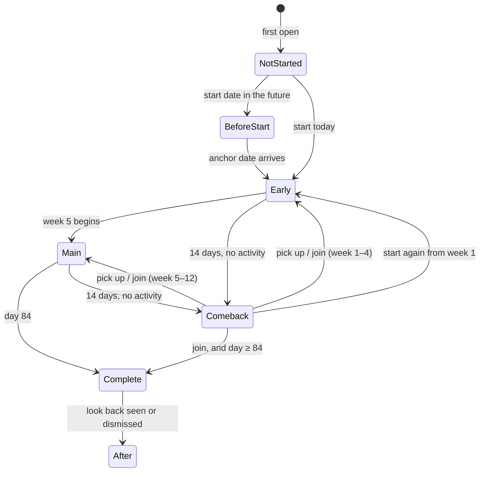

# UX flows: Artist's Sketchbook v1
**Phase 3: UX flows · started 2026-11-28 · v0.1**
**Built from:** `project-scope.md` v1, `research/user-stories.md` v1.2, `project-plan.md` → Decisions (to 2026-11-28).

---

## 0. The time and state model (S3)
*The spine of E3 and E6. Every flow below follows these rules. Status: **draft, waiting for my decisions (T1–T6 at the end of this section)**.*

### 0.1 Course time follows the calendar, from an anchor
- The app stores one **anchor date**: course day 1. Set by the start date (US-01).
- **Course day** = days since the anchor + 1. **Course week** = ⌈course day ÷ 7⌉.
- **Day 7** of every week (anchor + 6, + 13, + 20 …) is that week's check-in day (US-20).
- **Weeks 1–4** (early support, US-23) and **week 12** (US-24) are course weeks, never calendar weeks.
- By default the path moves on with the calendar (brief core loop). **Only three things move the anchor**:

| Action | Where | What happens to the anchor | Effect |
|---|---|---|---|
| **Join the current week** (or dismiss the card) | Comeback card (US-11) | Nothing | Same week, same day 7 |
| **Pick up where I left off** | Comeback card (US-11) | Moves so that **today = day 1 of the week I was in at my last activity** | I replay that week from its start; day 7 is 6 days from today; week 12 moves out by the same amount |
| **Start again from week 1** | Comeback card, secondary link | Today becomes day 1 | Week 1 again; all my notes, ideas and links stay |
| *Change my start date* | Settings (US-26) | Replaced (a correction, not a shift) | Week labels on past notes may change; the plain note says so |

- **Notes keep their date, never a week number.** The week shown next to an old note is worked out from the anchor that was in effect on that date, so picking up never relabels the past. (Store: a short anchor history `[{from_date, anchor}]`; Settings' correction replaces the whole history.)

**Worked example:** start Tue 1 Dec. Last activity Fri 18 Dec (week 3, day 18). Nothing until Sun 3 Jan (16 days, so the card shows).
- Join the current week → Sun 3 Jan is day 34, week 5. Next check-in: Mon 4 Jan (day 35).
- Pick up where I left off → Sun 3 Jan becomes day 15 (week 3, day 1). Next check-in: Sat 9 Jan. The anchor moved 19 days, so week 12 now ends 19 days later than planned.

### 0.2 The day boundary
- **A new day starts at 4:00 a.m. local time.** A 00:30 log belongs to the night's day (US-05).
- Every saved thing stores its timestamp **and** its day, fixed at save time. Days are never recalculated (travel or a time-zone change can't move a note).
- **"Yesterday"** (US-05) = the day before today by this rule. The "log yesterday" control shows only while yesterday has no pages entry; older days go through the comeback, not a date picker.

### 0.3 What counts as activity
- **Activity = anything I save**: pages done (today or yesterday), a capture, an idea, a note, an artist-date plan or done, a check-in reflection, a link, a theme merge.
- **Opening the app alone is not activity.** Neither is reading the pattern view or dismissing a card.
- **Gap** = days since the last activity. It is only used for one thing: **the 14-day comeback card (US-11)**. It is never shown, counted or worded anywhere (US-09, X2).

### 0.4 The check-in when day 7 passes
- On day 7 the check-in is **invited** on Today. If I don't open it, it **stays available** until the next week's day 7. Then it is quietly replaced by the new one. Check-ins **never stack** and the old one is never called missed.
- **It covers everything since the last check-in I opened** (or since day 1), labelled with the week it belongs to. Nothing that surfaced in a skipped week is lost, and the counts stay "what I made" only.
- Dismissing it hides it from Today for that week; it stays reachable from the week path (US-22) until it is replaced.
- **Week 12:** the course-complete look back (US-24) **takes the place of** the week-12 check-in, so there aren't two reflective moments in a row.

### 0.5 One thing at a time on open
Today always has the same base: **Pages done** (primary), **log yesterday** (only when relevant), **Add an idea** (quiet). Above it there is **one invitation slot**, filled by the first match:

| # | Shows | When |
|---|---|---|
| 1 | **Comeback card** (US-11) | Gap ≥ 14 days, the week at my last activity was ≤ 12, and the card hasn't been shown for this gap |
| 2 | **Course complete** (US-24) | Course day ≥ 84 (day 7 of week 12) and not seen yet |
| 3 | **Check-in** (US-20) | A check-in is open (0.4) and not dismissed this week |
| 4 | **The idea I'm carrying forward** (US-24) | After the course, if I picked one |
| — | Nothing | The calm, finished Today (US-08) |

- The comeback beats everything because its answer changes which week, check-in and ending apply.
- The slot is never filled with patterns, note or idea text (S11), a heavy-day line, or anything asking me to write.
- Nothing appears in the slot during the pages → capture flow; it waits for the next open.

### 0.6 Course states

| State | What's different |
|---|---|
| **Not started** | Onboarding (US-01, ≤ 2 screens) |
| **Before start** | Everything works (pages, ideas, artist dates); Today says when week 1 begins; notes are labelled "before the course" |
| **Early (weeks 1–4)** | Early-support framing on (US-23), pattern view low-key (US-13) |
| **Main (weeks 5–12)** | Early support off; a heavy day still gets its line, without "early" |
| **Comeback** | Not a screen: a card in the Today slot. Today still works underneath |
| **Complete** | The look back is shown once and can be reopened |
| **After** | Nothing locks. Week path shows the course as done; pages, capture, ideas and patterns keep working |

### 0.7 Decisions this needs (my recommendation first)
| # | Question | Recommend | Trade-off |
|---|---|---|---|
| **T1** | "Pick up" resumes at… | **day 1 of the week I was in** | Part of a week replays. Resuming on the exact day can put day 7 tomorrow, so the check-in comes almost at once |
| **T2** | Day boundary | **4 a.m.**, fixed in v1 | A night owl writing at 4:30 a.m. gets a new day. A setting can come later if real use shows the need |
| **T3** | Activity | **anything saved, not just opening** | US-11 says "any tap counts"; this narrows it to taps that save something. Opening the app daily without logging would still show the card after 14 days |
| **T4** | A skipped check-in | **stays until the next day 7, covers everything since the last one opened** | Its span varies (1–N weeks), but nothing that surfaced is lost and nothing stacks |
| **T5** | Week 12 | **the course-complete look back replaces the week-12 check-in** | One fewer weekly reflection, but two summaries in a row would read as homework |
| **T6** | Before the start date | **everything works, labelled "before the course"** | Notes before day 1 don't belong to a week; the alternative (locking until day 1) contradicts "nothing locks" |

*When decided: log each in `project-plan.md` → Decisions; update US-05, US-11 (activity wording), US-20, US-22, US-24; tick the checklist item.*

---

## 1. Core flows
*Next task, after section 0 is decided:* start · pages + capture + add an idea · pattern view + linking (manual + AI suggestions) · artist date · day-7 check-in · comeback · early support · 12-week path · course complete · settings.

## 2. States per screen
*After the flows.*
