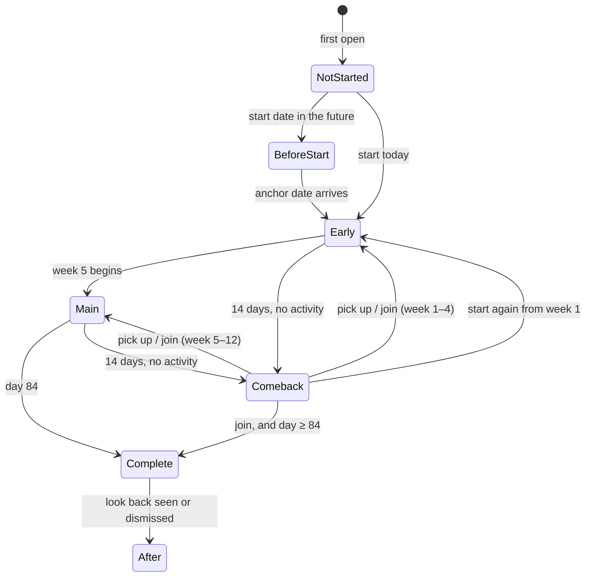
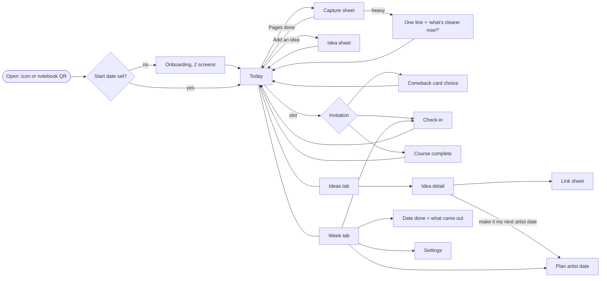

# UX flows: Artist's Sketchbook v1
**Phase 3: UX flows · started 2026-11-28 · v0.2 (time model decided; core flows drafted)**
**Built from:** `project-scope.md` v1, `research/user-stories.md` v1.2, `project-plan.md` → Decisions (to 2026-11-28).

---

## 0. The time and state model (S3)
*The spine of E3 and E6. Every flow below follows these rules. Status: **decided 2026-11-28** (T1–T6 approved as recommended; logged in Decisions).*

### 0.1 Course time follows the calendar, from an anchor
- The app stores one **anchor date**: course day 1. Set by the start date (US-01).
- **Course day** = days since the anchor + 1. **Course week** = ⌈course day ÷ 7⌉.
- **Day 7** of every week (anchor + 6, + 13, + 20 …) is that week's check-in day (US-20).
- **Weeks 1–4** (early support, US-23) and **week 12** (US-24) are course weeks, never calendar weeks.
- By default the path moves on with the calendar (brief core loop). **Only three things move the anchor**:

| Action | Where | What happens to the anchor | Effect |
|---|---|---|---|
| **Join the current week** (or dismiss the card) | Comeback card (US-11) | Nothing | Same week, same day 7 |
| **Pick up where I left off** | Comeback card (US-11) | Moves so that **today = day 1 of the week I was in at my last activity** | I replay that week from its start; day 7 is 6 days from today; week 12 moves out by the same amount |
| **Start again from week 1** | Comeback card, secondary link | Today becomes day 1 | Week 1 again; all my notes, ideas and links stay |
| *Change my start date* | Settings (US-26) | Replaced (a correction, not a shift) | Week labels on past notes may change; the plain note says so |

- **Notes keep their date, never a week number.** The week shown next to an old note is worked out from the anchor that was in effect on that date, so picking up never relabels the past. (Store: a short anchor history `[{from_date, anchor}]`; Settings' correction replaces the whole history.)

**Worked example:** start Tue 1 Dec. Last activity Fri 18 Dec (week 3, day 18). Nothing until Sun 3 Jan (16 days, so the card shows).
- Join the current week → Sun 3 Jan is day 34, week 5. Next check-in: Mon 4 Jan (day 35).
- Pick up where I left off → Sun 3 Jan becomes day 15 (week 3, day 1). Next check-in: Sat 9 Jan. The anchor moved 19 days, so week 12 now ends 19 days later than planned.

### 0.2 The day boundary
- **A new day starts at 4:00 a.m. local time.** A 00:30 log belongs to the night's day (US-05).
- Every saved thing stores its timestamp **and** its day, fixed at save time. Days are never recalculated (travel or a time-zone change can't move a note).
- **"Yesterday"** (US-05) = the day before today by this rule. The "log yesterday" control shows only while yesterday has no pages entry; older days go through the comeback, not a date picker.

### 0.3 What counts as activity
- **Activity = anything I save**: pages done (today or yesterday), a capture, an idea, a note, an artist-date plan or done, a check-in reflection, a link, a theme merge.
- **Opening the app alone is not activity.** Neither is reading the pattern view or dismissing a card.
- **Gap** = days since the last activity. It is only used for one thing: **the 14-day comeback card (US-11)**. It is never shown, counted or worded anywhere (US-09, X2).

### 0.4 The check-in when day 7 passes
- On day 7 the check-in is **invited** on Today. If I don't open it, it **stays available** until the next week's day 7. Then it is quietly replaced by the new one. Check-ins **never stack** and the old one is never called missed.
- **It covers everything since the last check-in I opened** (or since day 1), labelled with the week it belongs to. Nothing that surfaced in a skipped week is lost, and the counts stay "what I made" only.
- Dismissing it hides it from Today for that week; it stays reachable from the week path (US-22) until it is replaced.
- **Week 12:** the course-complete look back (US-24) **takes the place of** the week-12 check-in, so there aren't two reflective moments in a row.

### 0.5 One thing at a time on open
Today always has the same base: **Pages done** (primary), **log yesterday** (only when relevant), **Add an idea** (quiet). Above it there is **one invitation slot**, filled by the first match:

| # | Shows | When |
|---|---|---|
| 1 | **Comeback card** (US-11) | Gap ≥ 14 days, the week at my last activity was ≤ 12, and the card hasn't been shown for this gap |
| 2 | **Course complete** (US-24) | Course day ≥ 84 (day 7 of week 12) and not seen yet |
| 3 | **Check-in** (US-20) | A check-in is open (0.4) and not dismissed this week |
| 4 | **The idea I'm carrying forward** (US-24) | After the course, if I picked one |
| — | Nothing | The calm, finished Today (US-08) |

- The comeback beats everything because its answer changes which week, check-in and ending apply.
- The slot is never filled with patterns, note or idea text (S11), a heavy-day line, or anything asking me to write.
- Nothing appears in the slot during the pages → capture flow; it waits for the next open.

### 0.6 Course states

| State | What's different |
|---|---|
| **Not started** | Onboarding (US-01, ≤ 2 screens) |
| **Before start** | Everything works (pages, ideas, artist dates); Today says when week 1 begins; notes are labelled "before the course" |
| **Early (weeks 1–4)** | Early-support framing on (US-23), pattern view low-key (US-13) |
| **Main (weeks 5–12)** | Early support off; a heavy day still gets its line, without "early" |
| **Comeback** | Not a screen: a card in the Today slot. Today still works underneath |
| **Complete** | The look back is shown once and can be reopened |
| **After** | Nothing locks. Week path shows the course as done; pages, capture, ideas and patterns keep working |

### 0.7 Decisions (all approved as recommended, 2026-11-28)
| # | Question | Recommend | Trade-off |
|---|---|---|---|
| **T1** | "Pick up" resumes at… | **day 1 of the week I was in** | Part of a week replays. Resuming on the exact day can put day 7 tomorrow, so the check-in comes almost at once |
| **T2** | Day boundary | **4 a.m.**, fixed in v1 | A night owl writing at 4:30 a.m. gets a new day. A setting can come later if real use shows the need |
| **T3** | Activity | **anything saved, not just opening** | US-11 says "any tap counts"; this narrows it to taps that save something. Opening the app daily without logging would still show the card after 14 days |
| **T4** | A skipped check-in | **stays until the next day 7, covers everything since the last one opened** | Its span varies (1–N weeks), but nothing that surfaced is lost and nothing stacks |
| **T5** | Week 12 | **the course-complete look back replaces the week-12 check-in** | One fewer weekly reflection, but two summaries in a row would read as homework |
| **T6** | Before the start date | **everything works, labelled "before the course"** | Notes before day 1 don't belong to a week; the alternative (locking until day 1) contradicts "nothing locks" |

*Logged in `project-plan.md` → Decisions; US-05, US-11, US-20, US-22, US-24 updated (stories v1.3).*

---

## 1. Core flows
*Status: **draft v0.2, 2026-11-28**. Structure only: screen names and copy are placeholders until Phase 4; every line of copy will be our own words.*

### 1.0 The map
Three places, one tab bar. Every flow starts from one of them.

| Tab | Holds | Stories |
|---|---|---|
| **Today** | Pages done · log yesterday · Add an idea · the one invitation slot (§0.5) | E2, E3, US-20 entry, US-24 entry |
| **Ideas** (the pattern view) | Recurring ideas → all ideas → themes; idea detail; linking; merge | E4, US-18 |
| **Week** | This week (theme, artist date, check-in) · all 12 weeks · Settings | E5, E6, US-26 |

**Rules for every flow**
- Every sheet closes with one tap and loses nothing already saved. Skip is as big as Save (US-06).
- Confirmations are announced in a live region; undo stays on screen until I leave it, never on a timed toast (X1).
- After any sheet closes, I land back on Today, finished-looking (US-08). No "next step" is pushed.
- No flow shows a gap, a streak, a page-day count or a mood series (X2).

---

### F1. Start the course · US-01, US-02, US-03
**Trigger:** first open (no start date).
1. **Screen 1:** one or two lines on what the app is (the pages stay on paper; the app keeps only short notes), one line that starting again is normal (C1). Primary: **Continue**.
2. **Screen 2:** start date: **Today** (default) or **Pick a date**. Primary: **Start**.
3. → **Today.** Before the start date: Today says when week 1 begins; everything works (T6).
4. **Once, as a dismissible line on Today** (not a third onboarding screen): "Add to home screen" (iOS / Android steps in a sheet) and "Print the notebook card". Both stay in Settings.

**Exits:** done in under a minute; nothing asks about streaks, targets or goals.
**Edge:** reopening mid-onboarding returns to screen 1 with nothing lost (nothing was saved).

### F2. Pages done + capture · US-04, US-05, US-06, US-07
**Trigger:** I open the app after writing.
1. **Today → Pages done** (one tap). Live-region confirmation; the button becomes "Pages done ✓" with a quiet **Undo** and a quiet **They were shorter** toggle (US-04).
2. **Capture sheet** opens over Today (dismissible, Skip as visible as Save):
   - **How did the pages feel?** Icon + word options, including the wordless "heavy" (C3, R1).
   - **Themes:** 1–2 free-text chips; suggestions are my own past themes, in either language (combobox, X1).
   - **An idea:** one free-text field; no autocomplete (S1). Saved as "after pages".
   - **Save** or **Skip**. A capture with only a mood is valid.
3. **If "heavy" was picked**, after Save the sheet shows **one line** (weeks 1–4: "an early dip is normal" variant; week 5+: without "early") and an optional **What's clearer now?** field. Skip is one tap. An answer is saved as a **note**, with a quiet **Make it an idea** (→ idea marked "after a heavy page") (US-07, S7).
4. → Today, finished.

**Log yesterday (US-05):** while yesterday has no pages entry, Today shows a second control, **Yesterday's pages**, which runs the same steps 1–3 dated yesterday. It disappears once used or once the day turns over at 4 a.m. (T2).
**Edit later:** any capture opens from its idea or theme in the Ideas tab or from that day in the week view; edit or delete there (US-06).
**Edge:** tapping Pages done twice on the same day does nothing new (US-04). Closing the app mid-capture keeps the pages entry; the unsaved capture is dropped without a warning.
**Speed check:** icon → Today → Pages done = 1 tap after opening, under 5 s (#1 build constraint).

### F3. Add an idea · US-27
**Trigger:** any day, pages or not.
1. **Today → Add an idea** (quiet, secondary to Pages done).
2. **Idea sheet:** one text field + **Where did it come from?** (on its own · after an artist date; "after pages" is set only by F2). Default: on its own.
3. **Save** → live-region confirmation → Today.
**Rules:** no mood, no theme, no pages question; counts as activity (T3), never as pages.
**Also from:** artist date done (F5, prefilled "after an artist date").

### F4. Ideas tab: patterns + linking · US-12, US-13, US-14, US-15, US-16, US-18, US-28
**Trigger:** I open the Ideas tab. Never pushed.
1. **Fewer than 5 captures (US-13):** a plain **"So far"** list: my ideas (newest first) and my themes, counted plainly. Calm empty state in weeks 1–2: what will appear here, no score, no "write more".
2. **From 5 captures:** text-first, in this order (C2):
   - **Recurring ideas:** groups made only from links I confirmed, each with "came up N times".
   - **All ideas**, newest first, each with its source (after pages / after a date / on its own / after a heavy page).
   - **Themes**, counted, as context. No mood timeline (S6).
3. **Idea detail:** every wording in the group (originals kept, `lang` set per note), and for each: date, how the pages felt that day, themes around it, source. If it became an artist date: date → "what came out of it" (US-19). Actions: **Same idea as…**, **Unlink**, **Rename group**, **Make it my next artist date** (US-18 → F5 prefilled).
4. **Same idea as… (manual link, US-28):** a searchable list of my other ideas → pick one → confirm → group updates; undo stays on screen.
5. **AI suggestions (S1b), only if turned on in Settings:** a quiet "Possible links (N)" row at the top of Ideas. Each pair: both wordings side by side, **Link** / **Not the same**. Nothing counts until I tap Link. If AI is off or fails, the row is simply not there.
6. **Themes → Merge (US-14):** select 2+ themes → pick the name to show → confirm; undo available; future suggestions use the merged name.
7. **"So far" recap (US-15, Should):** a mode switch at the top: plain numbers of what I made (weeks, ideas, artist dates, notes), moods only next to ideas. No page days.
**Never here:** notes from heavy days in the ideas list (S7); "most missed"; percentages.

### F5. Artist date · US-17, US-18, US-19
**Trigger:** Week tab → This week → Artist date (or from an idea, F4 step 3).
1. **Plan:** optional text + optional day. A few small suggestions in our own words (about 30 min, at home, across my media); weeks 1–4 lean toward "small counts" (US-23). From an idea: text prefilled, editable, linked to the idea.
2. **Done:** one tap on the planned (or an unplanned) date → optional one sentence **What came out of it?** → optional **Save an idea from it** (→ F3 prefilled "after an artist date").
3. → back to the Week tab.
**Edge:** a week with no date shows the date slot empty and neutral, no "missed" (US-19). An unfinished plan simply carries into next week's slot when I open it, without comment.

### F6. Day-7 check-in · US-20, US-23
**Trigger:** the Today slot on day 7 (§0.5), or Week tab → This week → Check-in, until the next day 7 (T4).
1. **What surfaced** since the last check-in I opened: recurring ideas, new links, themes (with AI on: possible links to confirm here).
2. **What I made:** small neutral counts (ideas, artist dates, notes). Never page days (S5).
3. **Artist date:** prefilled from my taps; if none, one neutral line + one small at-home suggestion.
4. **One optional reflection line** (our own prompt); weeks 1–4 add permission framing (US-23).
5. **Done** → the next week is already open (weeks never lock) → Today.
**Exits:** under 2 minutes; **Not now** at any step hides it from Today for this week (it stays in the Week tab).
**Week 12:** no check-in; F9 takes its place (T5).

### F7. Comeback · US-08, US-09, US-10, US-11
**Under 14 days without activity:** no flow. The app opens on the normal Today (US-10). Yesterday can still be logged.
**From 14 days (§0.3, T3):** the Today slot shows the comeback card, once per gap:
1. One sentence of inspiration (our own words).
2. Two **equal** cards (C4): **Pick up where I left off** (week N again from its day 1, T1) · **Join the current week** (week M).
3. A secondary text link: **Start again from week 1**.
4. Choosing → anchor updated (§0.1) → one plain confirmation line ("You're in week N") → the card is gone; Today underneath was usable the whole time.
**Dismiss (×)** = join the current week. No "missed", no "pause", no day count anywhere.

### F8. The light 12-week path + early support · US-22, US-23
**Where:** Week tab.
1. **This week:** week number, a short theme in our own words, the artist date slot, the check-in (when open).
2. **All 12 weeks:** a simple list; none locked; past weeks open to show their ideas, dates and check-in reflection; the current week marked by text + shape, not color only. Before the start: "Starts on {date}". After the course: all 12 shown as done, no score.
3. **Early support (weeks 1–4):** not a screen. A flag that switches on permission framing in F2 (heavy line), F5 (suggestions) and F6 (reflection). Off from week 5.

### F9. Course complete · US-24
**Trigger:** the Today slot from day 84 (T5), once; reopenable from the Week tab.
1. **A look back:** recurring ideas first, then idea → artist date → what came out of it. No stats beyond plain counts of what I made.
2. **Which idea do I want to keep going with?** Pick one, or **None for now**. One tap.
3. → Today. After the course, the chosen idea sits in the slot (§0.5 #4); everything keeps working.
**No** confetti, no "the end" screen for stopping early (that's the "so far" recap).

### F10. Settings · US-25, US-26, US-21
**Where:** Week tab → Settings.
- **Start date:** change, with a plain note that week labels on past notes may change (§0.1 correction).
- **Notebook card** (US-03) · **Add to home screen** (US-02).
- **Idea links with AI:** off by default; one line on what's sent (only idea text).
- **Help resources:** off by default (US-21, Should); one static help line is always shown, on or off.
- **Download my notes** (US-25): one file, export only.
- **Delete all my data:** confirmation sheet offers **Download first**; then a second, explicit confirm; then onboarding.

---

### 1.1 Decisions this needs (my recommendation first)
| # | Question | Recommend | Trade-off |
|---|---|---|---|
| **F-a** | Navigation | **Three tabs: Today · Ideas · Week** (Settings inside Week) | A tab bar costs ~56 px of height on every screen; a single scrolling Today would hide the pattern view, which is the product's reason to exist |
| **F-b** | Where artist dates live | **Week tab, not Today** | One more tap to plan a date, but Today stays calm with one slot (US-08) |
| **F-c** | Capture as | **a sheet over Today** | A full screen gives more room, but a sheet keeps "Skip" obvious and Today visible underneath, so it never feels like a form |
| **F-d** | Home-screen and card prompts | **one dismissible line on Today after onboarding, not a 3rd onboarding screen** | Easier to miss, but onboarding stays at 2 screens (US-01) |

## 2. States per screen
*After the flows.*
